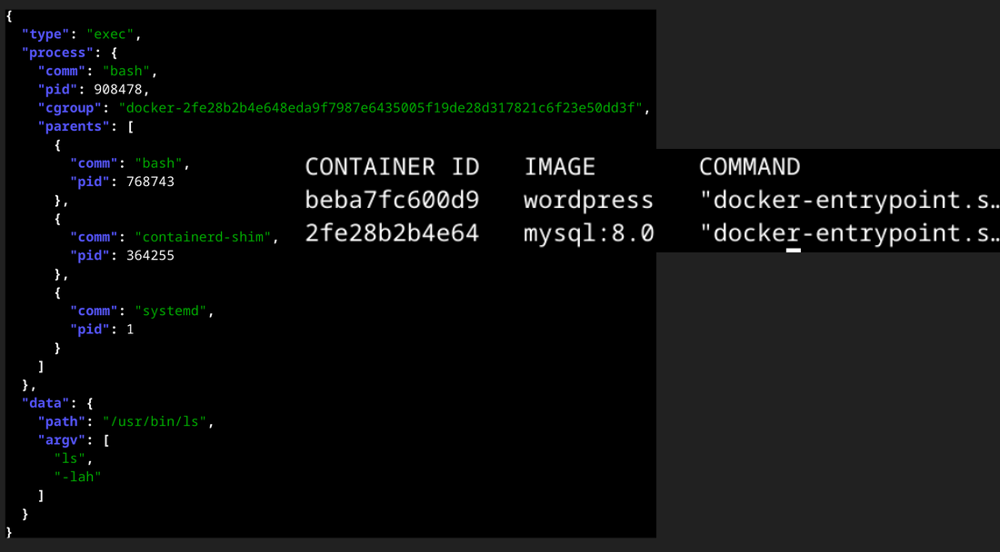

<div align="center"></div>

# GoSnoop

Trace what the machine is doing, system wide, with eBPF:

* **exec** — every program that is executed, with its arguments and (optionally) its environment
* **file** — the `stat`, `open` and `creat` families of syscalls, with the path resolved
* **dns** — outgoing DNS queries, with the questions decoded
* **network** — which process connected to, accepted a connection from, or sent datagrams to which IP address and port, over TCP or UDP, IPv4 or IPv6

Every event carries the process that caused it plus its ancestry, and is printed
to stdout as one JSON object per line.

# Example



# The `network` event

```json
{
  "type": "network",
  "process": { "comm": "curl", "pid": 4242, "parents": [{ "comm": "bash", "pid": 4100 }] },
  "data": {
    "protocol": "tcp",
    "direction": "outbound",
    "family": "ipv4",
    "remote": { "ip": "104.20.23.154", "port": 443, "scope": "public", "domain": "example.com" },
    "local": { "ip": "10.0.2.15", "port": 43802 },
    "uid": 1000,
    "netns": 4026531833
  }
}
```

`process` is the same context every event carries. In `data`:

| Field | Meaning |
| --- | --- |
| `protocol` | `tcp` or `udp` |
| `direction` | `outbound` (this process connected, or sent) or `inbound` (this process accepted a TCP connection) |
| `family` | `ipv4` or `ipv6`, as seen on the wire: an `AF_INET6` socket talking to an IPv4-mapped address (`::ffff:a.b.c.d`) is reported as `ipv4` with the plain IPv4 address |
| `remote.ip`, `remote.port` | the other end |
| `remote.scope` | `loopback`, `private`, `link-local`, `multicast`, `unspecified` or `public`, so `-collectors network` output can be cut down to "leaves this machine" with `jq 'select(.data.remote.scope == "public")'` |
| `remote.domain` | the name `remote.ip` was last looked up as, when GoSnoop saw a DNS answer for it; left out otherwise. Only set for `outbound` events. See [Domain names](#domain-names) |
| `local.ip`, `local.port` | this end. `local.ip` is left out when the kernel has not picked a source address yet, which happens for an unbound UDP socket |
| `connected` | UDP only. `true` if the socket was `connect()`ed and the datagram went to that peer, `false` if the send named its own destination (`sendto`) |
| `uid` | the uid of the process, which is not the same thing as the user who started it if it called `setuid` |
| `netns` | inode of the socket's network namespace, matching `/proc/<pid>/ns/net`. Useful to tell containers apart: the same `127.0.0.1:8080` in two namespaces is two different endpoints |

## What counts as a connection

* **TCP, outbound**: one event per `connect()` attempt, reported when the SYN is
  about to be sent. It says the process *tried* to connect, not that the peer
  answered: a refused or unreachable connect still produces an event.
* **TCP, inbound**: one event per `accept()`, attributed to the process that
  called it. `remote` is the client and `local.port` is the listening port.
* **UDP**: there is no handshake, so a connection is the **first datagram a
  socket sends to a given remote address and port**. Later datagrams on that
  flow are not reported, so a process talking to one server all day is one
  event, while one socket `sendto`-ing a hundred destinations is a hundred.
  Only outbound datagrams are observed; a UDP server that merely receives is
  not reported until it replies.

DNS queries also show up here as UDP flows to port 53 (and the `dns` collector
still decodes the question). Expect the occasional `systemd-resolved` or
`chronyd` event: those are real traffic from real processes.

## Domain names

An IP address alone says little, so outbound connections carry `remote.domain`
when the address came out of a DNS lookup. GoSnoop watches DNS answers as the
process that asked receives them (a `udp_recvmsg` / `udpv6_recvmsg` kretprobe on
datagrams from port 53), remembers which name resolved to which address, and
looks the remote address up when it reports a connection.

```sh
sudo ./gosnoop -collectors network | jq -c 'select(.data.remote.domain) | [.process.comm, .data.remote.domain, .data.remote.port]'
```

* It works behind a local stub resolver such as `systemd-resolved`
  (`127.0.0.53`), because the answer is picked up on the application's side, not
  just the resolver's.
* The name is the one the application **asked for**, not the end of a CNAME
  chain: `www.example.com`, not `edge.cdn.example.net`.
* It needs no `dns` collector. Asking for `network` starts the answer watcher on
  its own; if it cannot be attached GoSnoop warns that connections will have no
  `remote.domain` and carries on.
* Everything is by address, system wide. When several names point at one address
  (a CDN edge, shared hosting) the **most recently looked up** name wins, so the
  label is a strong hint rather than proof. Only a lookup GoSnoop saw can be
  matched: a connection to a literal IP, an address from `/etc/hosts`, a cached
  answer from before GoSnoop started, DNS over TCP, DoH and DoT all come out
  without a domain.
* Answers are kept for their TTL, but at least 5 minutes and at most an hour,
  because applications keep connecting to an address long after its TTL ran out.
  At most 65,536 addresses are remembered.
* Network events are held back for 20 ms before the lookup, so that the answer
  and the connection that follows it, which arrive through different buffers,
  cannot be handled in the wrong order. Event order is preserved.
* `inbound` events never get a domain: a client address that happens to match a
  name we looked up is more likely a coincidence than a hostname.

## What was left out, and why

Before settling on these fields the hooks were checked for what else they could
give cheaply. Included because they cost one field read: `uid`, `netns`,
`connected`, and `scope` (computed in userspace). Evaluated and left out:

| Idea | Verdict |
| --- | --- |
| Socket cookie, to correlate with other tooling | **Not possible.** `bpf_get_socket_cookie` and `bpf_get_netns_cookie` cannot be called from kprobe or tracepoint programs (checked on 7.2.11). The socket pointer is not a stable identity, and exposing a kernel address is a leak. |
| Connect failures (errno) and connect latency | **Follow-up.** The SYN-sent hook runs before the outcome is known. Needs a second hook on the state change to `ESTABLISHED`/`CLOSE`, which runs in softirq context, so the process would have to be remembered per socket in a map. |
| Connection duration, bytes, packets, retransmits | **Follow-up.** Same mechanism: a `close` event carrying the totals from `tcp_sock`, joined to the connect event by socket. Worth doing as its own event type rather than stretching this one. |
| UDP bytes per datagram | **Rejected.** Meaningless when only the first datagram of a flow is reported. Per-datagram reporting is a firehose (DNS alone) and belongs behind a flag. |
| UDP receive side / inbound datagrams | **Follow-up.** `udp_recvmsg` is hot and would need the same flow de-duplication. |
| Resolved hostname for `remote.ip` | **Done**, as `remote.domain`; see [Domain names](#domain-names). Reverse DNS at report time was rejected: slow, wrong for CDNs, and it makes GoSnoop itself emit DNS. |
| TLS server name (SNI) | **Rejected.** It means parsing the first bytes of every TCP send, is blind to ECH, and is the most privacy-sensitive thing on the list. |
| Unix-domain sockets | **Follow-up.** Not IP, and a different hook (`unix_stream_connect`). Loopback IP traffic is already covered by `remote.scope`. |
| `cgroup` | Observation: on this cgroup v2 host `process.cgroup` is empty for *every* collector, not only this one. It predates the network collector and is worth its own look. |

# Requirements

* Linux 5.8 or later (the probes use BPF ring buffers)
* a kernel built with BTF — `CONFIG_DEBUG_INFO_BTF=y`, which exposes
  `/sys/kernel/btf/vmlinux`. Every mainstream distribution ships this.
* tracefs mounted at `/sys/kernel/tracing` (or `/sys/kernel/debug/tracing`)
* root, or `CAP_BPF`, `CAP_PERFMON` and `CAP_SYS_RESOURCE`

x86-64 and arm64 are both supported. GoSnoop checks all of this at startup and
tells you which requirement is missing instead of dumping a loader error.

# Usage

```
gosnoop [flags]
```

| Flag | Meaning |
| --- | --- |
| `-collectors exec,file,dns,network` | which collectors to run (default: all of them) |
| `-pid 123,456` | only report events from these pids |
| `-pid-tree 123` | only report events from these pids and anything they spawned |
| `-comm bash,curl` | only report events from processes with these command names |
| `-exclude-comm node` | drop events from these command names |
| `-envp` | include the environment of exec events (noisy, and often sensitive) |
| `-include-self` | report GoSnoop's own events, which are hidden by default |
| `-keep-going` | keep running when some collectors fail to start (default: true) |
| `-version` | print the version and exit |

```sh
# everything
sudo ./gosnoop

# just the DNS lookups, as they happen
sudo ./gosnoop -collectors dns

# what does this build actually run and read?
sudo ./gosnoop -pid-tree $(pgrep -f 'make build')

# who is curl talking to?
sudo ./gosnoop -collectors network -comm curl

# pipe it through jq
sudo ./gosnoop -collectors exec | jq -r '.process.comm + ": " + .data.path'
```

If one collector cannot start — an unsupported kprobe, a tracepoint this kernel
does not have — GoSnoop prints a warning explaining why and keeps running with
the rest. Pass `-keep-going=false` if you would rather it stopped.

# Build

You need Go (see `go.mod` for the minimum), `clang` and the libbpf headers.
`clang` compiles the eBPF C into BPF bytecode; nothing links against the host
libc, so no `gcc-multilib` or glibc development headers are required.

```sh
# Debian / Ubuntu
sudo apt install clang llvm libbpf-dev

# Fedora / RHEL
sudo dnf install clang llvm libbpf-devel

# Arch
sudo pacman -S clang llvm libbpf
```

Then:

```sh
make generate   # compile the eBPF programs and regenerate the Go bindings
make build      # build the binary (static, CGO_ENABLED=0)
make test
make help       # all targets
```

`make generate` is only needed after changing something under `ebpf/`; the
generated `.o` files and bindings are checked in, so a plain `go build` works
from a clean checkout without clang.

If libbpf's headers are somewhere clang does not look by default, point
bpf2go at them:

```sh
BPF2GO_CFLAGS="-O2 -g -Wall -Werror -I/path/to/libbpf/include" make generate
```

# Troubleshooting

### `parsing .BTF header: header contains non-zero byte` / `non-zero trailer`

The kernel's BTF uses a header format that is newer than the `github.com/cilium/ebpf`
version GoSnoop was built against. Upgrade the dependency and rebuild:

```sh
go get github.com/cilium/ebpf@latest && make generate build
```

This is what made GoSnoop fail to start on kernels that set `hdr_len = 32`.

### `GoSnoop cannot probe the kernel: ... permission denied`

eBPF needs privileges. Run it under `sudo`, or grant the binary the
capabilities it needs:

```sh
sudo setcap cap_bpf,cap_perfmon,cap_sys_resource+ep ./gosnoop
```

On some hardened kernels `kernel.unprivileged_bpf_disabled=2` blocks the
capability route entirely and only root will do.

### `/sys/kernel/btf/vmlinux is missing`

The kernel was built without BTF, so CO-RE has nothing to relocate against.
There is no workaround short of a kernel with `CONFIG_DEBUG_INFO_BTF=y`. This
mostly shows up on custom or embedded kernels, and on some older LTS images.

### `no tracefs found`

Mount it:

```sh
sudo mount -t tracefs tracefs /sys/kernel/tracing
```

### `the <name> collector is disabled: ... attaching kprobe to udp_sendmsg`

The kernel function the probe hooks is not traceable here — it may be inlined,
renamed, or in the kprobe blacklist. The other collectors keep running. The DNS
collector is the usual casualty, since `udp_sendmsg` is the only hook it has.

### `network: not tracing ...` / `network: cannot probe tcp_connect`

The network collector attaches each of its hooks independently, so a kernel that
lacks one only loses that one: no `udpv6_sendmsg` (IPv6 compiled out) means no
IPv6 UDP events. If `tcp_connect` cannot be probed GoSnoop falls back to a
tracepoint, which still reports outgoing TCP but cannot know the local port
yet, so `local.port` is `0` on those events.

### `network events will have no remote.domain`

The DNS answer watcher could not be attached (`udp_recvmsg` inlined, renamed or
blacklisted, or the verifier said no). Connections are still reported, just
without `remote.domain`. A line starting `dns-answers: not watching ...` means
only one of IPv4 and IPv6 could be hooked.

### `file: not tracing sys_enter_open, sys_enter_newstat, ...`

Expected on arm64 and other architectures that never had those syscalls; the
equivalents (`openat`, `newfstatat`) are traced instead.

### `the kernel verifier rejected the program`

A GoSnoop bug on your kernel version. The full verifier log is printed with the
warning — please open an issue with it and your `uname -r`.

### No events at all

By default GoSnoop hides its own pid so it does not trace itself reporting on
itself. If you are testing with a filter, check it matches: `-comm` wants the
kernel's `comm` (truncated to 15 characters for the current process), not a
path.

# TODO

* Build terminal UI to inspect captured data
* Add non path arguments for newfstatat syscall
* Support dns over TCP
* Network: a `close` event with connect failures, duration and byte counts; UDP receive side; Unix sockets (see the table under "The `network` event")

# References
* https://gist.github.com/oghie/b4e3accf1f87afcb939f884723e2b462 https://medium.com/@nurkholish.halim/a-deep-dive-into-ebpf-writing-an-efficient-dns-monitoring-2c9dea92abdf
* https://github.com/whoopscs/dnsflux/blob/1870de1d70049f97849acc184a24c0f29f925e5a/platform/bpf/dnsfilter.c#L90
* https://github.com/iovisor/bcc/commit/c110a4dd0c8f8e15e3107f3a0807683a81657cbf#diff-7e530bfb3b516e09e3747909a2e21b8ae66651315b1930ee144a5a9f82e749a8R99 Rocky Xing for handling FD
